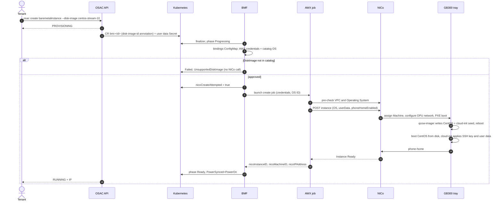
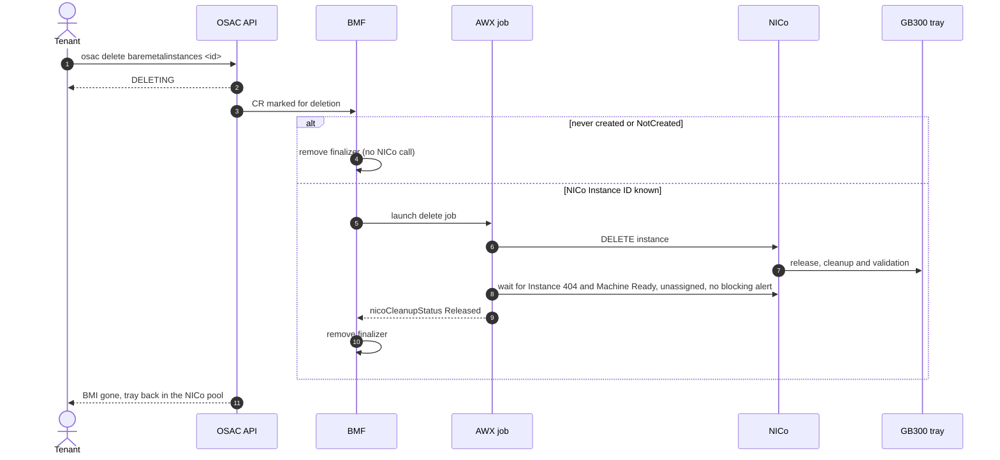

# OSAC → NICo Bare Metal Instance Workflow

How a tenant BareMetalInstance (BMI) becomes an installed, reachable GB300
host through NICo, and how it is released. It describes branch
`osac-7315-nico-boot-source` (OSAC-7315), on top of the NICo BMaaS pilot.

## Components

| Component | Role |
|---|---|
| **OSAC API (fulfillment-service)** | Tenant-facing API. Validates the request, stores the BMI, creates the Kubernetes objects, and reports the public state. |
| **BMF (bare-metal-fulfillment-operator)** | Kubernetes operator. Picks the AWX credentials and the NICo Operating System, launches the AWX jobs, owns the BMI status and finalizer. |
| **AWX / AAP (`nico_bmaas` role)** | Talks to the NICo REST API: creates, waits for and deletes the NICo Instance. |
| **NICo** | Allocates the GB300 tray, configures the DPU network, boots the install, and reports readiness through phone-home. |
| **GB300 tray + BlueField-3 DPU** | Runs the installer and then the tenant OS. |

## Objects

| Object | Where | Created by | Purpose |
|---|---|---|---|
| BMI | OSAC API database | Tenant | The tenant request: catalog item, instance type, DiskImage, SSH key, network attachment |
| `BareMetalInstance` CR `bmi-<id>` | Kubernetes, `osac` namespace | fulfillment-service | Annotations `osac.openshift.io/tenant` and `osac.openshift.io/disk-image-id`; `templateParameters` with `sshPublicKey`, `imageURL`, `userDataSecret` |
| Secret `<bmi-id>-user-data` (key `userdata`) | Kubernetes, `osac` namespace | fulfillment-service | Tenant cloud-config, only if the tenant gave user data |
| ConfigMap `osac-nico-tenant-bindings` | Kubernetes, `osac` namespace | Administrator | `version: 2`: tenant/Subnet → AWX credential IDs, and the `operatingSystems` catalog DiskImage ID → NICo Operating System ID |
| AWX jobs | AWX | BMF | `osac-create-bare-metal-instance` and `osac-delete-bare-metal-instance` |
| NICo Operating System | NICo | Administrator | Templated iPXE `qcow-image` definition: pinned image URL and SHA, root label, disk, and `ds=nocloud-net;s=${tenant-cloudinit-url}` |
| NICo Instance `osac-<bmi-uid>` | NICo | AWX job | The allocation of one tray, labeled `osacBmiUid`, with phone-home enabled |

## Create

### Steps

1. **Tenant request.** The OSAC API checks that the DiskImage is mandatory and
   available, that its architecture matches, and that there is an SSH key or
   user data. Public state: `PROVISIONING`.
2. **Kubernetes objects.** fulfillment-service creates the `BareMetalInstance`
   CR with the DiskImage ID annotation, then the user data Secret.
3. **BMF.**
   - Adds the finalizer; phase `Progressing`.
   - Selects the AWX credentials by tenant and Subnet from the bindings
     ConfigMap.
   - Resolves the DiskImage ID through the `operatingSystems` catalog. With no
     entry, the BMI fails with `UnsupportedDiskImage` and never reaches NICo.
     That rejection is terminal.
   - Records `nicoCreateAttempted` (one create attempt only) and launches the
     AWX create job with the NICo Operating System ID.
4. **AWX job** (15-45 minutes).
   - Reads the SSH key and the user data Secret (retries up to 2 minutes).
   - Builds the `#cloud-config` with the tenant SSH key and user data.
   - Checks in NICo that the VPC belongs to the tenant and that the Operating
     System is `Ready`, `TemplatedIpxe`, `Synced` to the Site, and delivers
     user data.
   - `POST /instance` with the Operating System, the user data,
     `phoneHomeEnabled: true`, the FNN interface and the `osacBmiUid` label.
   - Polls the Instance every 10 seconds, up to 45 minutes.
5. **NICo and the tray.**

   | NICo | Tray |
   |---|---|
   | Instance `Pending`: assigns a Machine and configures the FNN network on the DPU | — |
   | Instance `Provisioning`, host `Assigned/Ready` | PXE → iPXE `qcow-image` → `qcow-imager` downloads the CentOS qcow2, checks its SHA, writes the disk and the cloud-init seed → reboot |
   | Still `Provisioning` | PXE → iPXE exit → CentOS boots from disk → cloud-init creates `cloud-user` with the SSH key and applies the tenant user data → phone-home POST |
   | Instance **`Ready`** | CentOS running and reachable over SSH |

6. **Job success.** The job publishes `nicoInstanceID`, `nicoMachineID` and
   `nicoIPAddress`.
7. **BMF.** Saves the IDs, sets phase `Ready` and `PowerSynced=PowerOn`.
   Public state: **`RUNNING`**, with the IP address.

> **Key Takeaway:** `RUNNING` means the installed OS booted and phoned home,
> not only that NICo allocated a tray or assigned an IP address.

### Failures

Every failed create job reports `nicoCreateOutcome`. The BMI becomes `Failed`
(public state `FAILED`) and the reason is in the CR condition for
administrators.

| Where it fails | Outcome | Examples | Delete |
|---|---|---|---|
| Before the create POST | `NotCreated` | Operating System missing in NICo, invalid user data, missing Secret, NICo answers 400/403/422 | No NICo cleanup needed |
| The POST outcome is unknown | `Uncertain` | Network timeout, 5xx | Site verification required |
| After the POST | `Created` with IDs | No phone-home within 45 minutes: install failure, unreachable phone-home URL | NICo releases the Instance |

## Delete

### Steps

1. **Tenant request.** fulfillment-service marks the CR for deletion. Public
   state: `DELETING`.
2. **BMF decision** (phase `Deleting`):

   | Situation | Action |
   |---|---|
   | No create attempt, or outcome `NotCreated` | Remove the finalizer without calling NICo |
   | NICo Instance ID known (with or without a Machine) | Launch the AWX delete job |
   | `Uncertain` with no IDs | Keep the finalizer; verify the Site manually |
   | Create job still running | Wait for it and decide from its outcome |

3. **AWX delete job** (up to 30 minutes).
   - Checks ownership: NICo tenant and `osacBmiUid` label.
   - `DELETE /instance/{id}`, then waits for HTTP 404.
   - If a Machine was assigned, waits for it to be `Ready`, `instanceId: null`
     and free of blocking alerts. NICo cleans the tray meanwhile
     (`Initializing`, validation).
   - Publishes `nicoCleanupStatus: Released` with the same IDs.
4. **BMF.** Checks that the IDs match and removes the finalizer. The CR
   disappears, the BMI is gone from the OSAC API, and the tray is back in the
   NICo pool.

## Where to look

| What | Command |
|---|---|
| Public state | `osac get baremetalinstances <id>` |
| Phase, conditions, NICo IDs and jobs (admin) | `kubectl -n osac get baremetalinstance bmi-<id> -o json \| jq .status` |
| Job details | AWX job output of `osac-create-bare-metal-instance` / `osac-delete-bare-metal-instance` |
| NICo | `nicocli instance get <id>`, `nicocli instance status-history <id>`, `nicocli machine get <id>` |
| The tray | Serial-over-LAN console: `ipmitool -I lanplus -H <bmc> -U <user> -E sol activate` |

> **NOTE:** During the install OSAC only shows `PROVISIONING`, and the NICo IDs
> reach the CR when the create job ends. Follow the progress in NICo or on the
> SOL console. Exposing intermediate progress is a planned follow-up.

## Site prerequisites (NICo operator)

- `site.phoneHomeUrl` in the NICo REST configuration reachable from tenant
  hosts (`:7777` for the embedded DPU agent).
- The image artifact server reachable from the tenant network.
- A generic boot disk selector: today `image_disk=smallest` picks the 0-byte
  BMC USB virtual disks, and the M.2 `by-path` differs between trays.
